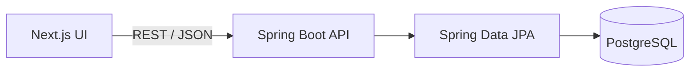

# StratoSpend

StratoSpend is a multi-cloud resource inventory and cost management application built with Spring Boot, Next.js and PostgreSQL.

The project follows a product-first approach: application features are implemented one vertical milestone at a time before the repository evolves into a complete DevSecOps platform with automated delivery, security scanning, Kubernetes, GitOps and observability.

> **Project status:** Milestones 1 and 2 are complete. StratoSpend manages cloud account and resource metadata; it does not connect to real cloud providers or collect credentials.

## Features

### Milestone 1 — Foundation and cloud accounts

- Spring Boot REST API and Next.js web application foundations
- PostgreSQL schema versioning with Flyway
- Cloud account registration, listing, lookup and update
- Account activation and deactivation without destructive deletion
- AWS, Azure and GCP provider model
- Development, staging and production environments
- Request validation and consistent API error responses

### Milestone 2 — Cloud resource inventory

- Cloud resources linked to an account, with category, provider service, region and status
- Inventory filtering by account, provider, category, region and status, with pagination and sorting
- Resource details page and resource editing; the account and external ID are fixed after registration
- Optional demo data for local development

All pages include loading, empty and error states and work on phone-sized screens; the resource pages also confirm successful changes. The backend has API, service and persistence tests; the frontend has component tests.

## Technology stack

| Area | Technology |
| --- | --- |
| Frontend | Next.js 16, React 19, TypeScript |
| Backend | Java 17, Spring Boot 3.5, Spring Web, Spring Data JPA |
| Database | PostgreSQL 17, Flyway |
| Testing | JUnit, Spring Boot Test, H2, Vitest, Testing Library |
| Local infrastructure | Docker Compose |

## Architecture



The backend uses a package-by-layer architecture:

```text
dev.sami.platform/
├── model/          JPA entities and domain enums
├── repository/     Persistence interfaces
├── service/        Business rules and use cases
├── controller/     REST endpoints
├── dto/            API request and response contracts
├── exception/      Domain exceptions
└── common/         Shared error handling, CORS configuration and the demo data loader
```

Request and response DTOs keep the persistence model separate from the public API contract. See [docs/ARCHITECTURE.md](docs/ARCHITECTURE.md) for the domain rules and design decisions.

## Repository structure

```text
stratospend/
├── backend/        Spring Boot REST API
├── frontend/       Next.js web application
├── docs/           Architecture decisions and product roadmap
├── compose.yaml    Local PostgreSQL service
├── .env.example    Example local configuration
└── Makefile        Common development commands
```

## Run locally

### Prerequisites

- Java 17 or newer
- Maven 3.9 or newer
- Node.js 24 and npm
- Docker Desktop with Linux containers enabled

### 1. Clone the repository

```bash
git clone https://github.com/sami3l/stratospend.git
cd stratospend
```

### 2. Start PostgreSQL

Copy the example environment file and start the database:

```bash
cp .env.example .env
docker compose up -d database
```

PowerShell alternative:

```powershell
Copy-Item .env.example .env
docker compose up -d database
```

The default database configuration is:

```text
Database: cloudcost
Username: cloudcost
Password: cloudcost-local
Host port: 5433
```

The backend uses these values by default. If you change them in `.env`, also start the backend with matching values:

```text
DB_URL=jdbc:postgresql://localhost:5433/cloudcost
DB_USERNAME=cloudcost
DB_PASSWORD=cloudcost-local
```

When running from IntelliJ IDEA, add these values to the application's **Run/Debug Configuration**. Spring Boot does not load the `.env` file automatically.

### 3. Start the backend

```bash
cd backend
mvn spring-boot:run
```

The API starts at <http://localhost:8080>.

### 4. Start the frontend

Open another terminal:

```bash
cd frontend
npm install
npm run dev
```

Open <http://localhost:3000>. The frontend calls the API at `http://localhost:8080` by default; to use another address, set `NEXT_PUBLIC_API_URL` in `frontend/.env.local`.

| Page | Purpose |
| --- | --- |
| `/` | Register, list, activate and deactivate cloud accounts |
| `/resources` | Browse, filter, sort and add cloud resources |
| `/resources/{id}` | View and edit one resource |

### Load demo data (optional)

To fill a local database with sample accounts and resources, start the backend with the `demo` profile instead of step 3:

```bash
make backend-demo
```

This runs `mvn spring-boot:run -Dspring-boot.run.profiles=demo` and imports 3 accounts (AWS, Azure and GCP) and 24 resources from `backend/src/main/resources/demo/demo-data.json`. The import only adds records that are missing: existing accounts and resources are never modified or deleted, so restarting with the profile keeps your edits. Without the `demo` profile, no demo data is loaded.

## API endpoints

### Cloud accounts

Base path: `/api/v1/cloud-accounts`

| Method | Endpoint | Description |
| --- | --- | --- |
| `GET` | `/api/v1/cloud-accounts` | List all cloud accounts |
| `GET` | `/api/v1/cloud-accounts/{id}` | Get an account by ID |
| `POST` | `/api/v1/cloud-accounts` | Register an account |
| `PUT` | `/api/v1/cloud-accounts/{id}` | Update account details |
| `PATCH` | `/api/v1/cloud-accounts/{id}/status?active={boolean}` | Activate or deactivate an account |

Example request:

```bash
curl -X POST http://localhost:8080/api/v1/cloud-accounts \
  -H "Content-Type: application/json" \
  -d '{
    "name": "development-account",
    "provider": "AWS",
    "externalAccountId": "123456789012",
    "environment": "DEVELOPMENT",
    "region": "eu-west-3"
  }'
```

### Cloud resources

Base path: `/api/v1/cloud-resources`

| Method | Endpoint | Description |
| --- | --- | --- |
| `GET` | `/api/v1/cloud-resources` | List resources with filters, pagination and sorting |
| `GET` | `/api/v1/cloud-resources/{id}` | Get a resource by ID |
| `POST` | `/api/v1/cloud-resources` | Register a resource under an existing account |
| `PUT` | `/api/v1/cloud-resources/{id}` | Update name, category, provider service, region and status |

Resources are not deleted; set their status to `INACTIVE` instead. The account and external resource ID cannot be changed after registration.

List query parameters, all optional:

| Parameter | Values |
| --- | --- |
| `cloudAccountId` | Positive account ID; an unknown account returns `404` |
| `provider` | `AWS`, `AZURE` or `GCP` |
| `category` | `COMPUTE`, `STORAGE`, `DATABASE`, `NETWORK`, `CONTAINER`, `SERVERLESS` or `OTHER` |
| `region` | Lowercase letters, digits and hyphens, such as `eu-west-3` or `global` |
| `status` | `ACTIVE`, `INACTIVE` or `UNKNOWN` |
| `page` | Zero-based page number, default `0` |
| `size` | Page size from `1` to `100`, default `20` |
| `sort` | `field,asc` or `field,desc` where field is `id`, `name`, `category`, `providerService`, `region`, `status`, `createdAt` or `updatedAt`; default newest created first |

The list response contains `content`, `page`, `size`, `totalElements` and `totalPages`.

Example request:

```bash
curl -X POST http://localhost:8080/api/v1/cloud-resources \
  -H "Content-Type: application/json" \
  -d '{
    "cloudAccountId": 1,
    "externalResourceId": "arn:aws:ec2:eu-west-3:123456789012:instance/i-0abc123",
    "name": "web-server",
    "category": "COMPUTE",
    "providerService": "EC2",
    "region": "eu-west-3",
    "status": "ACTIVE"
  }'
```

### Errors

Errors use one JSON format:

```json
{
  "timestamp": "2026-10-26T12:00:00Z",
  "status": 400,
  "message": "Validation failed",
  "errors": { "region": "must contain only lowercase letters, digits or hyphens" }
}
```

| Status | Meaning |
| --- | --- |
| `400` | Invalid input, including unknown or immutable fields in a request body; `errors` lists field problems |
| `404` | The account or resource does not exist |
| `409` | The account or resource is already registered |

## Run the tests

Backend tests and coverage report:

```bash
cd backend
mvn verify
```

Frontend linting, tests and production build:

```bash
cd frontend
npm run lint
npm test
npm run build
```

## Security note

StratoSpend stores account and resource identifiers and descriptive metadata only. Do not add cloud access keys, secret keys, tokens or other credentials to records, environment files or Git history.

## License

This project is licensed under the [MIT License](LICENSE).
