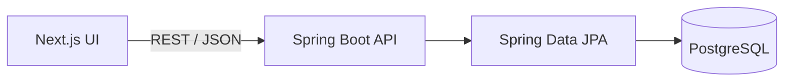

# Application architecture

## Overview



The backend uses a package-by-layer architecture. Request and response DTOs keep the persistence model out of the public API contract.

```text
dev.sami.platform/
├── controller/    REST endpoints and HTTP concerns
├── service/       Use cases and business rules
├── repository/    Spring Data persistence interfaces
├── model/         JPA entities and domain enums
├── dto/           API request and response contracts
├── exception/     Domain exceptions
└── common/        Shared API exception handling, CORS configuration and the demo data loader
```

Flyway owns the schema. Each change gets a new migration; applied migrations are never edited.

## Cloud account rules

1. Providers are limited to AWS, Azure and GCP.
2. Environments are development, staging and production.
3. Provider plus external account ID must be unique.
4. Cloud credentials are never collected in this milestone.
5. Deactivation is used instead of deletion so future cost history remains attached.
6. Provider and external ID cannot be changed after registration; descriptive fields can be updated.

## Cloud resource rules

1. Every resource belongs to one existing cloud account. Its provider comes from that account and is not stored separately.
2. External resource ID plus account must be unique. External IDs are case-sensitive and stored exactly as sent; names and provider services are trimmed.
3. The account and external resource ID cannot be changed after registration. Name, category, provider service, region and status can be updated. Unknown or immutable fields in a request body are rejected.
4. Resources are never deleted. A resource that no longer exists is marked `INACTIVE`, so future cost history remains attached.
5. Categories are compute, storage, database, network, container, serverless and other. Statuses are active, inactive and unknown.
6. Regions contain only lowercase letters, digits and hyphens. `global` is used for resources that have no region.
7. Resources can currently be registered under an inactive account.

### Listing

- Filters: account, provider, category, region and status. Filtering by an account that does not exist returns `404` instead of an empty page.
- Pages are zero-based with a size from 1 to 100, default 20.
- Sorting accepts only approved fields. The default order is newest created first, and the ID is always added as a final tie-breaker so pages stay stable when timestamps are equal.
- The owning account is fetched with the resource, so listing a page does not issue one extra query per row.

## API

| Method | Endpoint | Purpose |
| --- | --- | --- |
| `GET` | `/api/v1/cloud-accounts` | List accounts |
| `GET` | `/api/v1/cloud-accounts/{id}` | Get one account |
| `POST` | `/api/v1/cloud-accounts` | Register an account |
| `PUT` | `/api/v1/cloud-accounts/{id}` | Update descriptive fields |
| `PATCH` | `/api/v1/cloud-accounts/{id}/status?active=false` | Activate or deactivate |
| `GET` | `/api/v1/cloud-resources` | List resources with filters, pagination and sorting |
| `GET` | `/api/v1/cloud-resources/{id}` | Get one resource |
| `POST` | `/api/v1/cloud-resources` | Register a resource |
| `PUT` | `/api/v1/cloud-resources/{id}` | Update editable fields |

Errors share one format: `timestamp`, `status`, `message` and an `errors` map of field messages. Validation problems return `400`, missing records `404` and duplicates `409`.

## Frontend structure

```text
frontend/src/
├── app/          Routes: /, /resources and /resources/[id]
├── components/   Pages, tables and dialogs, each with its tests
├── hooks/        Data loading and form state
└── lib/          API clients, types, display labels and form validation
```

- Components never call `fetch` directly. API calls live in `lib/`, and hooks connect them to components.
- `useLoad` ignores responses that arrive after the request has changed, been retried or been unmounted, so stale data never appears.
- The create and edit resource dialogs share one form hook (`useResourceForm`), dialog shell and set of editable fields (`resource-form-dialog.tsx`).
- Next.js 16 passes dynamic route parameters as a promise. Route files are small server components that await them and pass plain values to client components.

## Decisions

| Decision | Reason |
| --- | --- |
| Demo data loads only under the `demo` Spring profile, not through a Flyway migration. | Flyway runs in every environment, so demo rows would reach production. The loader reuses the services and their validation, only adds missing records and runs in one transaction. |
| After an edit, the details page shows the `PUT` response instead of refetching. | The response is already the saved resource. A second request could fail and hide a successful save. |
| Malformed resource IDs in the URL show "not found" without calling the API. | The backend would reject them anyway, and the page avoids a pointless request. |
| Concurrent edits are not detected yet: the last save wins. | Detecting conflicts needs a version column and a new migration. It will be added as its own change. |
| Inventory filters live in component state. | Going back to the inventory resets them. Keeping filters in the URL is a planned improvement. |
